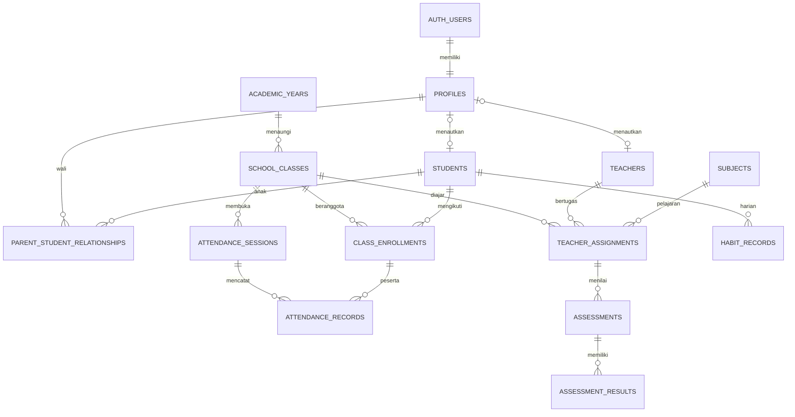

# Arsitektur database SI STIR HEBAT

Model operasional satu sekolah, direkonsiliasi pada 24 November 2026. Baseline lokal memutar **42 migrasi berurutan** dan menyisakan **53 tabel aplikasi di skema public**. Dokumen ini memakai nama fisik yang dipanggil aplikasi. Entitas yang diusulkan blueprint, seperti daftar peran dinamis dan log audit global, tetap menjadi usulan. [Migrasi](../supabase/migrations/) · [Blueprint asal](references/Database_Blueprint_SI_STIR_HEBAT.md) · [Matriks akses](RBAC_MATRIX.md)

## Dari identitas ke catatan sekolah

Seseorang di registri boleh belum memiliki akun. Aktivasi memberi peran pada profil terverifikasi. Admin kemudian menautkan akun ke registri guru atau siswa atau membuat pasangan wali–anak. Pencabutan wali menghapus pasangan aktif dan mempertahankan peristiwa penautan. UUID registri tetap menjadi identitas siswa lintas tahun meski nama, kelas, atau akun berubah.

## Peta tabel dan kepemilikan

| Domain | Tabel di public | Aturan penyimpanan |
| --- | --- | --- |
| Identitas dan otorisasi | `profiles`, `profile_role_changes`, `teachers`, `students`, `parent_student_relationships`, `account_relationship_events` | Profil memakai PK yang sama dengan Auth. Admin mengaktifkan profil pending satu kali. Pasangan wali–anak merupakan PK gabungan. Penautan dan event tersimpan dalam transaksi yang sama. |
| Sekolah dan kalender | `school_settings`, `academic_years`, `semesters`, `subjects`, `school_classes`, `school_calendar_events`, `grading_settings` | Kelas dimiliki tahun ajaran. Semester dan rentang kalender diperiksa di DB. KKM berupa satu baris konfigurasi. |
| Pengajaran dan jadwal | `class_enrollments`, `teacher_assignments`, `lesson_schedules`, `lesson_schedule_events`, `schedule_proposals` | Indeks unik parsial membatasi satu kelas aktif per siswa per tahun. Jadwal mengikat penugasan, hari, menit, rentang efektif dan revisi. |
| Kehadiran siswa | `attendance_sessions`, `attendance_records`, `attendance_changes`, `attendance_imports`, `guardian_absence_reports` | Satu sesi per kelas dan tanggal. Roster dan identitas siswa disalin saat sesi dibuat. Status kosong berarti belum diisi. Persetujuan laporan wali membutuhkan satu kecocokan sesi/peserta. |
| Kehadiran guru | `teacher_attendance`, `teacher_attendance_corrections`, `teacher_attendance_events`, `teacher_attendance_status_types` | Hari kerja memakai Asia/Jakarta. ID permintaan menjaga retry check-in/out dan pengajuan koreksi. Koreksi lolos setelah keputusan kepala sekolah. |
| Belajar dan evaluasi | `teaching_journals`, `teaching_modules`, `teaching_module_events`, `class_materials`, `task_submissions`, `task_feedback`, `task_feedback_events`, `assessments`, `assessment_results`, `assessment_result_events` | Materi dan tugas dibedakan melalui jenis materi. Asesmen menyimpan peserta dan identitas pelajaran historis. Publikasi menentukan akses keluarga. |
| Supervisi dan dokumen | `academic_supervisions`, `academic_supervision_events`, `school_documents`, `document_categories`, `document_versions`, `document_reviews`, `school_document_events`, `teacher_document_types` | Metadata versi, review, tahap dan status ada di PostgreSQL. Objek biner disimpan di bucket privat `supervision-evidence` dan `school-documents`. Akses berkas bergantung pada baris induk. |
| Pendampingan dan komunikasi | `habit_catalog`, `habit_records`, `habit_events`, `communication_messages`, `announcements`, `notifications` | Pasangan siswa/tanggal unik. Katalog berurutan memetakan tujuh indikator. Notifikasi menyimpan penerima dan referensi kejadian, sedangkan isi komunikasi berada di tabel pesan. |
| Retensi | `retention_policies`, `deletion_requests` | Permintaan menyimpan pengaju, keputusan kepala sekolah dan catatan pelaksanaan admin. Pelaksanaan penghapusan fisik mengikuti prosedur operator. |

## Batas transaksi dan akses

- **Pembacaan.** Browser memakai kunci publik dan JWT pengguna. Grant tabel/kolom membatasi operasi, RLS membatasi baris, dan fungsi di `school_private` mengevaluasi profil serta relasi. Kontrak lintas beberapa tabel diberikan melalui RPC terpilih seperti `guardian_attendance` dan `dashboard_overview`. [Kontrak API](API_CONTRACT.md)
- **Koreksi.** Editor kebiasaan mengambil satu pasangan siswa/tanggal. Entri baru memakai INSERT dengan batas unik. Koreksi memakai filter siswa, tanggal dan revisi awal. Trigger membatasi isi kepada wali dan bidang validasi kepada guru. Perubahan isi membatalkan validasi lama serta mencatat audit dalam transaksi yang sama. Benturan insert atau revisi memerlukan pembacaan ulang sebelum pengguna menimpa data.
- **Histori dan pelaporan.** FK memelihara referensi, kolom snapshot memelihara identitas historis. Rekap absensi agregat memakai ID siswa dan snapshot terakhir dalam rentang. Perubahan kelompok absensi melalui RPC agar seluruh perubahan dan audit berhasil bersama. Validasi impor mengikat berkas ke satu sesi. [Aturan absensi dan asesmen](DECISIONS.md)
- **Indeks.** Kunci unik `(student_id, record_date)` melayani editor harian, indeks keanggotaan aktif melayani pemeriksaan roster, dan indeks jadwal guru/kelas melayani pencarian benturan. Untuk indeks tambahan, ukur rencana kueri dengan filter peran serta volume representatif di lingkungan uji. [Kajian kapasitas](INFRA_SCALING_CACHE_DB.md)
- **Siklus hidup.** Nonaktifkan registri dan lepaskan tautan akun sesuai prosedur saat siswa keluar. Retensi sementara untuk registri, absensi, nilai, dan jurnal berlangsung selama terdaftar ditambah lima tahun ajaran. Audit lima tahun, komunikasi dan bukti supervisi satu tahun ajaran. [Keputusan](DECISIONS.md) · [Prosedur operator](PROSEDUR_RETENSI_OPERATOR.md)

## Evolusi dan pemulihan

1. Tambahkan berkas migrasi baru setelah timestamp terakhir. Untuk perubahan kontrak, dahulukan struktur yang dapat melayani frontend sebelumnya, uji pembaca/penulis, lalu alihkan klien.
2. Replay skema dari awal dengan `node --test tests/database.test.mjs` pada Node 24. Tes PGlite memakai kontrak Auth dan tabel metadata Storage sintetis. Untuk rilis, jalankan juga skenario HTTP Auth/PostgREST dan unggah/unduh berkas pada stack Supabase.
3. Bukti hosted 22 November mencatat 23 migrasi dan objek konfigurasi dengan definisi berbeda. Bandingkan timestamp, kolom, kebijakan, grant dan fungsi terhadap target sebelum promosi. Cadangan serta uji pemulihan mencakup database dan berkas Storage. Gunakan migrasi koreksi ke depan untuk drift. [Rekonsiliasi per objek](HOSTED_MIGRATION_RECONCILIATION_2026-11-22.md) · [Runbook](RUNBOOK_OPERASIONAL.md)
