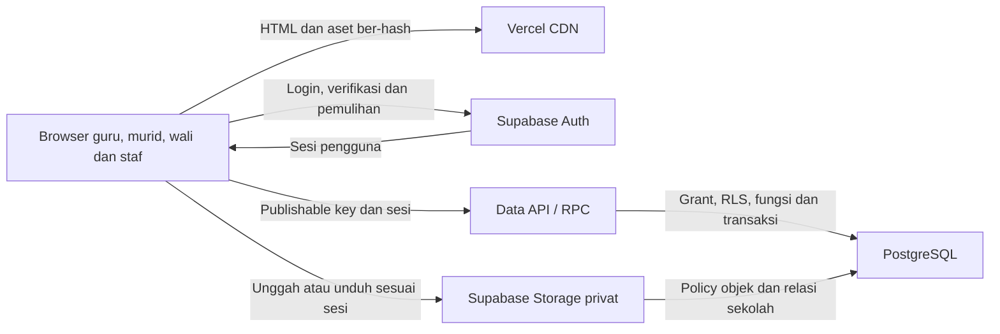

# Arsitektur server dan runbook operasional

Diperbarui 24 November 2026. Aplikasi sekolah memakai SPA React/Vite di Vercel dan Supabase untuk layanan backend. Berkas yang mengikat rancangan ini ialah [vercel.json](../vercel.json), [klien Supabase](../src/lib/supabase.ts), [konfigurasi lokal](../supabase/config.toml), dan [migrasi](../supabase/migrations/).



## Batas komponen dan alur permintaan

| Komponen | Tanggung jawab | Pemeriksaan operator |
| --- | --- | --- |
| Vercel | Melayani `dist/`; rute aplikasi seperti `/login` dan `/jadwal` memakai fallback `index.html`. Aset Vite di `/assets/` memiliki nama ber-hash dan cache publik immutable satu tahun. | Buka rute langsung, periksa tipe konten JS dan header cache pada aset yang disebut oleh HTML. |
| Auth | Membuat sesi dan menyediakan email verifikasi serta pemulihan. Registrasi meminta redirect ke `/login`, pemulihan ke `/kata-sandi`. | Cocokkan Site URL, redirect eksplisit tiap origin milik sekolah, status signup, dan pengiriman email pada target. [Konfigurasi redirect Supabase](https://supabase.com/docs/guides/auth/redirect-urls) |
| Data API dan PostgreSQL | Klien mengirim permintaan dengan kunci publishable. Login menambahkan identitas pengguna melalui sesi. Grant dan RLS menentukan baris/operasi. RPC mengelola aksi lintas tabel seperti publikasi atau persetujuan sesuai kontrak fitur. | Lacak error HTTP/SQLSTATE, versi migration dan cakupan peran. Endpoint, peran, dan daftar kontrak dapat ditelusuri di [kontrak API](API_CONTRACT.md). |
| Storage | Bucket privat `supervision-evidence` dan `school-documents` di migrasi lokal menyimpan berkas. Metadata dan policy membatasi tahap, pemilik, dan peran. | Uji unggah, unduh, dan pencabutan akses dengan akun UAT. Cocokkan bucket dan policy pada target. Cadangkan serta uji pemulihan objek bersama metadata database. |

Browser menggunakan dua variabel publik saat build, `VITE_SUPABASE_URL` dan `VITE_SUPABASE_PUBLISHABLE_KEY`. Simpan kredensial operator/administrasi di luar frontend. Respons data sekolah bergantung pada sesi dan tidak dicache publik. Kapasitas ditinjau dari latensi API, kueri lambat, koneksi, penggunaan Storage, dan error rate. [Catatan kapasitas](INFRA_SCALING_CACHE_DB.md)

## Lingkungan

| Lingkungan | Identitas data dan layanan | Bukti yang dihasilkan |
| --- | --- | --- |
| Pengembangan | Vite lokal, proyek uji yang ditunjuk pengembang, atau mode demo saat DEV dan konfigurasi kosong | Perilaku antarmuka dan perubahan fitur |
| CI | Endpoint sintetis, PGlite dengan migrasi dan Playwright dengan API tiruan | Regresi kode, kontrak SQL uji, izin, navigasi dan build |
| Preview/UAT | Build statis dengan proyek Supabase uji, email dan lima peran yang disetujui | Rute langsung, Auth/SMTP, interaksi peran, akses Storage dan kecocokan migrasi |
| Produksi | Deployment dan proyek sekolah yang telah disetujui pemilik | Status deployment, smoke, log layanan dan bukti pemulihan |

## Smoke anonim

Pakai alamat deployment yang hendak diperiksa. Untuk pemeriksaan frontend saja, kosongkan kedua variabel Supabase pada proses. Untuk menambahkan pemeriksaan Data API, isi keduanya dengan konfigurasi publik proyek tujuan.

```powershell
node scripts/smoke-production.mjs https://DOMAIN-SEKOLAH
```

Smoke memeriksa HTML beranda, fallback `/login`, dan modul JavaScript utama yang ditunjuk HTML. Pemeriksaan demo pada semua chunk dilakukan saat build. Dengan konfigurasi Supabase, smoke meminta `profiles?select=id&limit=0` memakai header `apikey`. Status 401/403 dengan SQLSTATE `42501` membuktikan penolakan izin database. Respons 200, kegagalan validasi kunci, atau galat gateway membuat pemeriksaan gagal. [Kunci API Supabase](https://supabase.com/docs/guides/getting-started/api-keys)

`npm run check:supabase` memeriksa pengaturan Auth, penolakan anonim pada tabel yang terdaftar di skrip, dan RPC dashboard. Keberhasilan pemeriksaan anonim belum menguji sesi guru, wali atau siswa. Untuk itu jalankan skenario pada [panduan UAT](PANDUAN_UAT.md).

## Gangguan dan pemulihan

| Gejala | Pemeriksaan pertama | Tindakan |
| --- | --- | --- |
| Beranda 200 tetapi rute langsung 404 atau aset mengembalikan HTML | Deployment ID, rewrite SPA, permintaan `/assets/`, tipe konten | Verifikasi output `dist/` dan ulangi smoke pada deployment kandidat. |
| Login, pendaftaran atau reset gagal | Auth, Site URL/redirect, SMTP/rate limit dan konfigurasi saat build | Uji dengan email UAT. Catat status dan waktu tanpa token, OTP, atau data murid. |
| Data API 404, RPC tidak tersedia atau policy berbeda | Bandingkan riwayat migrasi serta definisi objek/policy pada target dengan revisi aplikasi | Tahan promosi fitur; rekonsiliasi perbedaan dan uji di lingkungan terisolasi. |
| Fitur berhenti sesudah promosi | Cari deployment sehat yang kontraknya masih didukung skema | Setelah otorisasi, promosikan deployment sehat, ulangi smoke dan satu alur peran. Untuk perubahan skema gunakan migrasi perbaikan atau restore yang telah diuji. |
| Bukti/dokumen gagal dibuka | Metadata versi, path objek, bucket, status alur dan peran | Periksa dengan akun UAT yang tepat. Cocokkan keberadaan objek dan metadata setelah restore. |

Catat waktu mulai/pulih, revisi aplikasi, versi skema dan hasil verifikasi. Cadangan database dan objek Storage diuji terpisah lalu dicocokkan pada salinan terisolasi. Hasil restore, konfigurasi alert dan pemilik operasional perlu diverifikasi pada layanan target. Snapshot hosted terakhir dan perbedaan skema yang sudah diketahui dijelaskan di [rekonsiliasi hosted](HOSTED_MIGRATION_RECONCILIATION_2026-11-22.md). [Pipeline rilis](CI_RUNBOOK.md)
